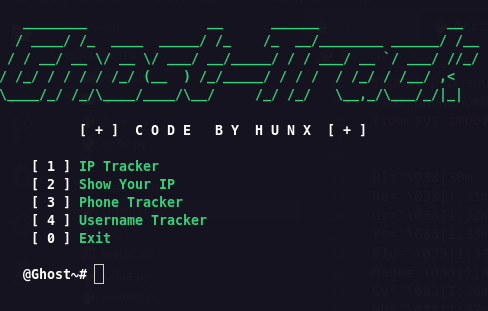
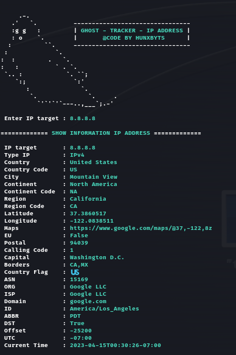
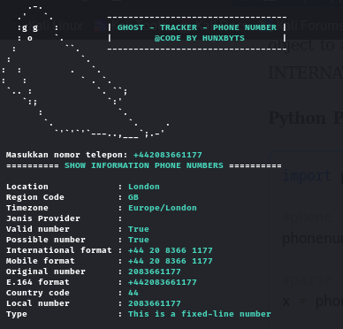
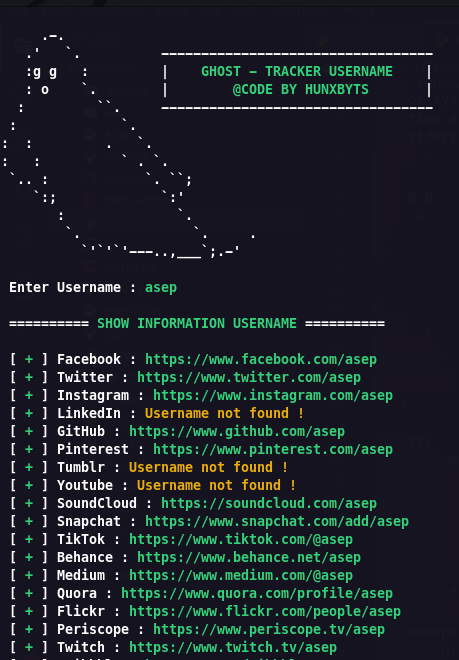

# GhostTrack 汉化版（GhostTrack 中文版）

> 追踪 IP、手机号、用户名的 OSINT 信息收集工具 —— 原项目
> [HunxByts/GhostTrack](https://github.com/HunxByts/GhostTrack)（⭐ 15.6k）的中文汉化版。
> **逻辑与原版逐字节一致，仅翻译界面文字与注释。**



汉化基线：原版 Version 2.2 · 全部功能保留（IP 追踪 / 显示本机 IP / 手机号追踪 / 用户名追踪）

> ⚠️ 本仓库为汉化镜像，一切权利归原作者 [HunxByts](https://github.com/HunxByts) 所有，
> 原项目未附开源许可证，详见 [NOTICE](NOTICE)。

## 🛠 安装

### Linux（deb 系）

```bash
sudo apt-get install git
sudo apt-get install python3
```

### Termux（Android）

```bash
pkg install git
pkg install python3
```

## 🚀 使用

```bash
git clone https://github.com/bayshier/ghosttrack-zh.git
cd ghosttrack-zh
pip3 install -r requirements.txt
python3 GhostTR.py
```

原版安装命令（如需上游版本）：

```bash
git clone https://github.com/HunxByts/GhostTrack.git
cd GhostTrack
pip3 install -r requirements.txt
python3 GhostTR.py
```

## 📡 功能菜单

### 1 · IP 追踪（IP Tracker）



输入目标 IP，返回归属地全套信息：国家、城市、经纬度、Google Maps 直链、
ASN / 组织 / 运营商 / ISP、时区与当地时间等。

> 💡 想拿到目标真实 IP？可配合 Seeker 一类工具生成跳转链接获取，
> 再回到本菜单查询。

<details>
<summary>⚡ 安装 Seeker：</summary>

- <strong><a href="https://github.com/thewhiteh4t/seeker">前往 Seeker 仓库</a></strong>
</details>

### 2 · 显示本机 IP（Show Your IP）

一键查询当前出口 IP。

### 3 · 手机号追踪（Phone Number Tracker）



输入手机号（国际格式，如 `+6281xxxxxxxxx`），返回：归属地、运营商、时区、
号码有效性、国际 / E.164 格式、号码类型（手机 / 固话）等。

### 4 · 用户名追踪（Username Tracker）



输入用户名，在 Facebook、Twitter/X、Instagram、LinkedIn、GitHub、TikTok
等 24 个社交平台逐一探测同名账号是否存在。

## 📦 本汉化版改动范围

| 内容 | 处理方式 |
|------|----------|
| `GhostTR.py` 界面文字 | 菜单、提示、结果字段全部中文化（69 处字符串映射） |
| `GhostTR.py` 逻辑代码 | **逐字节保留**：API 调用、解析、24 平台列表、菜单结构零改动（骨架 diff = 0） |
| 文件头印尼语注释 | 意译为中文，保留作者署名诉求原意 |
| `README.md` | 全文重写为中文 |
| `requirements.txt` / `asset/` | 原样保留 |

## ⚖️ 声明与许可

- 原项目 **未附带开源许可证**：版权归 [HunxByts](https://github.com/HunxByts) 所有，
  本仓库仅作学习交流用途的汉化传播，如有侵权请提 Issue，立即下架
- 原作者注释明确要求：魔改 / 重写请先征得许可，或直接 Fork 并保留其署名
  —— 请自觉遵守
- **免责声明**：本工具仅供网络安全学习与授权测试研究使用。追踪他人位置、
  手机号、社交账号信息可能违反法律与平台条款，请勿用于任何未经授权的
  用途，使用产生的一切后果由使用者自行承担
- 汉化部分按原项目同等权利发布；如原项目日后补充许可证，以原许可证为准
